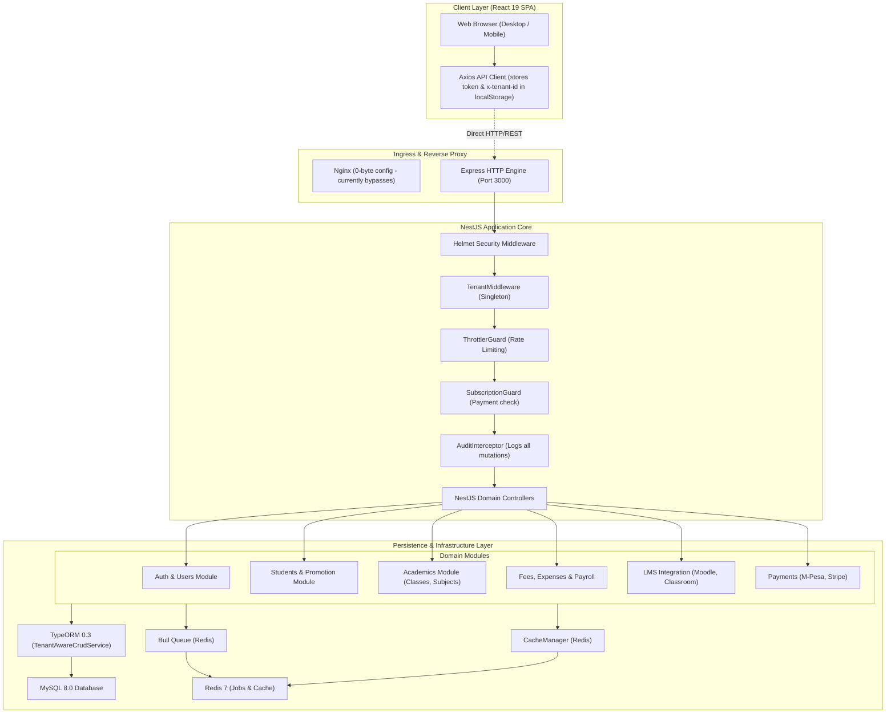
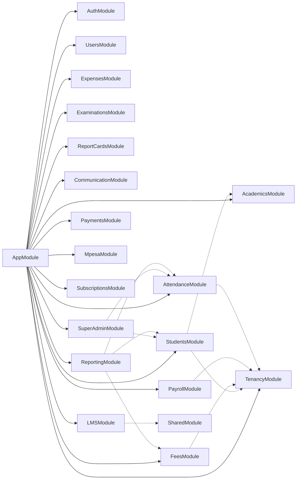

# Software Architecture and Code Quality Review

**Auditor:** Principal Software Architect  
**Evaluation Standard:** ISO/IEC 25010 Software Product Quality, Clean Architecture Principles  
**System Classification:** Enterprise Multi-Tenant Educational Management Information System (EMIS)  

---

## 1. Technology Stack and Repository Structure

### 1.1 Verified Technology Stack
- **Server Framework:** NestJS 11.0 running on Node.js (>=22.0.0 engine specification).
- **HTTP Adapter:** Express 5.0 (`@nestjs/platform-express`).
- **ORM / Persistence:** TypeORM 0.3.28 with `mysql2` driver (3.18.0).
- **Caching Layer:** `cache-manager` 7.2.8 with `cache-manager-redis-yet` 5.1.5 connected to Redis.
- **Job Queues:** Bull 4.16.5 with `@nestjs/bull` 11.0.4 backed by Redis.
- **Client Framework:** React 19.2.4 SPA bundled with Vite 5.2.0.
- **Styling & Animation:** Tailwind CSS 4.2.1, Framer Motion 12.34.3, Lucide React 0.575.0.
- **State Management & Routing:** React Context API (`AuthContext`, `LanguageContext`), React Router DOM 7.13.1.
- **Integrations:** Safaricom Daraja REST API (M-Pesa), Stripe SDK 20.4.0, Google APIs 171.4.0.

### 1.2 Repository Directory Layout
```
├── client/                     # React Frontend Single Page Application
│   ├── src/
│   │   ├── components/         # Reusable UI widgets (LanguageSelector, WhatsAppButton, CheckoutForm)
│   │   ├── contexts/           # AuthContext, LanguageContext
│   │   ├── i18n/               # Multi-language translations (en, fr, es, sw)
│   │   ├── pages/              # 27 SPA Route Views
│   │   └── services/           # Axios HTTP client instance and Stripe loader
├── src/                        # NestJS Backend Application
│   ├── common/                 # Global enums (UserRole, SubscriptionEnums)
│   ├── core/                   # Cross-cutting concerns (Tenancy, Audit, Guards, Decorators)
│   │   ├── common/             # TenantAwareCrudService
│   │   ├── interceptors/       # AuditInterceptor
│   │   └── tenancy/            # TenancyService, TenantMiddleware, TenantAwareEntity
│   ├── migrations/             # TypeORM database migration files
│   ├── modules/                # 21 Domain Modules (academics, students, fees, auth, lms, etc.)
│   └── shared/                 # CryptoService, EmailService
├── scripts/                    # CLI seeding scripts (seed.ts, create-super-admin.ts)
├── test/                       # E2E test suite (app.e2e-spec.ts)
└── docker-compose.yml          # Container orchestration manifest
```

---

## 2. Application Architecture & Component Interaction

### 2.1 System Architecture Diagram



### 2.2 Module Dependency Map



---

## 3. Structural Evaluation & Design Principle Adherence

### 3.1 Separation of Concerns & Modular Monolith Design
- **Strengths:** The NestJS modular architecture is logically sound. Functional domains are cleanly partitioned into self-contained feature directories (`students`, `academics`, `fees`, `payroll`).
- **Deficiencies:** Domain boundaries are leaked across persistence entities. For instance, `Student` entity ([student.entity.ts](file:///c:/Users/HP/Downloads/multitenacny-school-management-system-main%20(2)/multitenacny-school-management-system-main/src/modules/students/entities/student.entity.ts)) directly embeds unnormalized parent contact fields (`parentName`, `parentEmail`, `parentPhone`, `parentEmergencyContact`) while also storing a loose `parentId` string with no foreign key constraint.

### 3.2 SOLID Principles Compliance Review
1. **Single Responsibility Principle (SRP) — Violated:**
   - `ReportingService` ([reporting.service.ts](file:///c:/Users/HP/Downloads/multitenacny-school-management-system-main%20(2)/multitenacny-school-management-system-main/src/modules/reporting/reporting.service.ts)) injects 9 distinct repositories (`Fee`, `Expense`, `Payroll`, `Student`, `Attendance`, `Examination`, `Subject`, `TimetableEntry`, `ReportCard`) and acts as a monolithic query aggregator, financial calculator, Excel generator, and dashboard builder.
   - `TenantMiddleware` performs JWT parsing, token signature verification, tenant database lookup, and session binding in a single middleware method.
2. **Open/Closed Principle (OCP) — Partially Respected:**
   - The LMS integration defines an interface `LmsProvider` with concrete implementations `MoodleProvider` and `GoogleClassroomProvider`. However, `LmsService.getProvider()` relies on a rigid `switch(connection.provider)` statement that requires modifying the service every time a new provider is added.
3. **Liskov Substitution Principle (LSP) — Violated (Fake Stubs):**
   - `CanvasProvider` ([canvas.provider.ts](file:///c:/Users/HP/Downloads/multitenacny-school-management-system-main%20(2)/multitenacny-school-management-system-main/src/modules/lms/providers/canvas.provider.ts)) implements `LmsProvider`, but every method throws `new Error('Canvas provider is not yet implemented.')`. Calling code expecting an `LmsProvider` crashes.
4. **Interface Segregation Principle (ISP) — Respected:**
   - Domain interfaces are concise and appropriately scoped.
5. **Dependency Inversion Principle (DIP) — Violated:**
   - In `LmsService.getProvider()`, provider classes are instantiated directly using `new MoodleProvider(...)` and `new GoogleClassroomProvider(...)` with concrete dependencies rather than being resolved via the NestJS dependency injection container.

---

## 4. Technical Debt, "Vibe-Coding" & Disconnected Features

The codebase exhibits clear characteristics of "vibe-coded" or generative AI development where visual UI surfaces were generated without corresponding functional backend wiring:

```
+----------------------------------------------------------------------------------------------------+
|                                    "VIBE-CODING" EVIDENCE MATRIX                                   |
+------------------------------+------------------------------+--------------------------------------+
| Feature / Screen             | Frontend Presentation        | Actual Backend Implementation        |
+------------------------------+------------------------------+--------------------------------------+
| Teacher Gradebook            | Full grade entry table with  | Pure static mock array.              |
| (TeacherGradingPage.tsx)     | student names, remarks input | handleSave() triggers browser        |
|                              | and Save button.             | alert('Grades saved successfully!'). |
|                              |                              | Zero API calls.                      |
+------------------------------+------------------------------+--------------------------------------+
| Teacher Attendance           | Class roster with Present /  | Hardcoded mock student list.         |
| (TeacherAttendancePage.tsx)  | Absent / Late toggles.       | handleSave() triggers browser        |
|                              |                              | alert('Attendance saved!').          |
|                              |                              | Zero API calls.                      |
+------------------------------+------------------------------+--------------------------------------+
| Teacher Classes              | List of assigned courses,    | Hardcoded mock data wrapped in       |
| (TeacherClassesPage.tsx)     | student counts, and rooms.   | setTimeout(..., 500).                |
|                              |                              | Zero API calls.                      |
+------------------------------+------------------------------+--------------------------------------+
| Student Management           | Page titled "Students        | Only provides an Excel file upload   |
| (StudentsManagementPage.tsx) | Management".                 | form. No student table, no search,   |
|                              |                              | no edit, no delete, no profile view. |
+------------------------------+------------------------------+--------------------------------------+
| Stripe Card Payment          | CheckoutForm with card input | Calls /payments/create-payment-      |
| (CheckoutForm.tsx)           | and Pay button.              | intent which does not exist in       |
|                              |                              | backend controller (Returns 404).    |
+------------------------------+------------------------------+--------------------------------------+
| Staff Employee ID            | UI form requires entering    | 'employeeId' does not exist in       |
| (StaffManagementPage.tsx)    | 'Employee ID'.               | backend Staff entity or database.    |
+------------------------------+------------------------------+--------------------------------------+
| Canvas LMS Integration       | Selectable option in LMS     | Class methods all throw              |
| (CanvasProvider.ts)          | connect dropdown.            | 'Not yet implemented' errors.        |
+------------------------------+------------------------------+--------------------------------------+
```

---

## 5. Transaction Boundaries & Database Consistency

1. **Absence of Atomic Transactions in Multi-Step Mutations:**
   - **Student Promotions:** `PromotionService.promoteStudents()` maps over students and executes `this.studentRepository.save(updatedStudents)` without a transaction runner.
   - **Bulk Attendance:** `AttendanceController.bulkCreate()` executes `Promise.all(records.map(...))` creating individual repository save promises. A database disconnection halfway through leaves half the attendance records saved and half lost with no rollback.
   - **School Registration:** `AuthService.registerSchool()` creates a Tenant, generates a bcrypt salt, hashes the password, and creates an Admin User. If user creation fails, the tenant record is permanently orphaned in the database.
2. **Missing Database Integrity Constraints:**
   - `Fee.studentId`, `Payroll.staffId`, `ReportCard.studentId`, `ReportCard.examinationId`, and `Attendance.studentId` are defined as bare varchar columns without foreign key constraints to their target entities. Deleting a student leaves orphaned fee, attendance, and grade records in the database.

---

## 6. Pragmatic Architecture Recommendations

We strongly advise **against** attempting to decompose this application into microservices. For educational institutions and national EMIS deployments, a well-structured **Modular Monolith** provides the highest reliability, operational simplicity, and data consistency.

### Architectural Roadmap:
1. **Adopt NestJS ClsModule for Tenancy:** Replace the problematic singleton middleware and request-scoped service pattern with `nestjs-cls` (Context Local Storage). This provides thread-safe, request-isolated tenant context across all services and TypeORM subscribers without DI scope complications.
2. **Enforce TypeORM Subscribers for Row-Level Isolation:** Implement a TypeORM Entity Subscriber (`TenantSubscriber`) that automatically injects `tenantId` on all `INSERT` operations and automatically appends `WHERE tenantId = :currentTenantId` on all `SELECT`, `UPDATE`, and `DELETE` queries, eliminating manual `tenantId` handling in services.
3. **Refactor Reporting Module into Domain Projections:** Break up `ReportingService` into domain-specific projection handlers (`FinancialReportingService`, `AttendanceReportingService`, `AcademicReportingService`) with pre-aggregated summary tables to eliminate runtime N+1 queries.
4. **Normalize Parent and Guardian Records:** Extract parent contact information from `Student` entity into a dedicated `Guardians` table with a many-to-many relationship (`student_guardians`) supporting multi-child families and emergency contacts.
