# Dependency-Aware Remediation Roadmap

**Project:** SaaSLink Multi-Tenant Education Management Information System (EMIS)  
**Total Estimated Remediation Effort:** 65 Person-Days  
**Execution Horizon:** 8 Weeks across 4 Phased Milestones  

---

## 1. Roadmap Architecture & Phase Progression

```mermaid
flowchart TD
    subgraph Phase0 ["Phase 0: Immediate Security & Data Protection (Days 1–10)"]
        P0_Cache["SEC-001: Scoped Redis Caching"]
        P0_Audit["SEC-002: Audit Log Redaction"]
        P0_Creds["SEC-003: Remove Hardcoded Secrets"]
        P0_Mpesa["SEC-004: M-Pesa IP & Signature Guard"]
        P0_Stripe["SEC-005: RawBody Stripe Webhook"]
        P0_Migrate["DAT-001: Native MySQL Migrations"]
        P0_DTO["ARC-001: Decorate Domain DTOs"]
    end

    subgraph Phase1 ["Phase 1: Core Architecture & Access Control (Days 11–25)"]
        P1_Roles["SEC-006 & SEC-007: RolesGuard & Auth"]
        P1_Msg["SEC-008: Message Isolation"]
        P1_Reset["SEC-009: Hashed Password Resets"]
        P1_CLS["ARC-002: AsyncLocalStorage Tenancy"]
        P1_Ledger["FUN-001: Historical Enrollment Ledger"]
        P1_ReportCard["FUN-002: Multi-Subject Report Cards"]
        P1_QA["QAL-001: Automated Release Test Suite"]
    end

    subgraph Phase2 ["Phase 2: UI/UX, Performance & Accessibility (Days 26–45)"]
        P2_Teacher["UI-001: Live Teacher Portals"]
        P2_Student["UI-002: Full Student Management CRUD"]
        P2_WCAG["UI-003: WCAG 2.2 AA Accessibility"]
        P2_Session["UI-004: 401 Session Interceptor"]
        P2_Index["DAT-002: Composite DB Indexes"]
        P2_Perf["PER-001: Resolve N+1 Dashboard Queries"]
    end

    subgraph Phase3 ["Phase 3: DevSecOps & Enterprise Procurement (Days 46–60)"]
        P3_Docker["OPS-001: Hardened Multi-Stage Docker"]
        P3_Deps["SEC-011: Dependency Vulnerability Patching"]
        P3_Consent["PRV-001: Parental Consent & Age Verification"]
        P3_Policy["PRV-002: Accurate Legal Privacy Docs"]
        P3_SEO["SEO-001: Robots.txt & Portal Disallows"]
    end

    Phase0 --> Phase1
    Phase1 --> Phase2
    Phase2 --> Phase3
```

---

## 2. Phase Breakdown and Deliverables

### Phase 0: Immediate Security & Data Protection (Days 1–10)
**Objective:** Eliminate critical vulnerabilities (P0 release blockers), prevent cross-tenant data leakage, stop cleartext password logging, and unblock the global API validation pipeline.

| ID | Task Description | Owner | Effort | Dependencies | Target Outcome |
|---|---|---|:---:|---|---|
| **SEC-001** | Replace global `CacheInterceptor` with tenant-partitioned cache keys (`${tenantId}:${url}`). | Security / Backend | 2 Days | None | Zero cross-tenant data leakage in Redis. |
| **SEC-002** | Add recursive key masking (`password`, `token`, `secret`) to `AuditInterceptor`. | Security / Backend | 1.5 Days | None | Zero plaintext credentials written to `audit_logs`. |
| **SEC-003** | Remove hardcoded admin credentials from `create-super-admin.ts`; enforce strict env validation. | Security / Backend | 1 Day | None | No default credentials committed in codebase. |
| **SEC-004** | Enforce Safaricom IP subnets and transaction state checks on `/api/mpesa/callback`. | Security / Backend | 2 Days | None | External forged payment callbacks rejected with 403. |
| **SEC-005** | Enable `{ rawBody: true }` in `main.ts` bootstrap and verify Stripe signatures. | Backend | 1 Day | None | Stripe webhooks validate HMAC and update subscriptions. |
| **DAT-001** | Rewrite database migrations with native MySQL 8.0 DDL; purge SQLite syntax. | Database / Backend | 2 Days | None | Clean migration execution on fresh MySQL database. |
| **ARC-001** | Add `class-validator` decorators across all 15 naked domain DTO classes. | Backend | 3 Days | None | API write operations succeed with HTTP 201 instead of 400. |

**Milestone Gate 0:** Zero confirmed P0 vulnerabilities; fresh MySQL database deploys and passes automated migration test.

---

### Phase 1: Core Architecture, Authorization & Reliability (Days 11–25)
**Objective:** Enforce strict server-side access control, eliminate privilege escalation, implement thread-safe tenancy context, and establish longitudinal educational records.

| ID | Task Description | Owner | Effort | Dependencies | Target Outcome |
|---|---|---|:---:|---|---|
| **SEC-006** | Remove `role` updates from `UsersController.update`; block tenant admin escalation. | Security / Backend | 1 Day | Phase 0 | Admins cannot elevate accounts to SuperAdmin. |
| **SEC-007** | Enforce `RolesGuard` on `Fees`, `Expenses`, `Payroll`, and `Examinations` controllers. | Security / Backend | 2 Days | Phase 0 | Non-admin roles blocked from sensitive endpoints. |
| **SEC-008** | Scope `CommunicationController.findAll` to messages where user is sender/recipient. | Privacy / Backend | 1 Day | Phase 0 | Zero tenant-wide message snooping. |
| **SEC-009** | Hash password reset tokens with SHA-256; set token to `null` upon reset. | Security / Backend | 1 Day | Phase 0 | Reset tokens secured against leakage and reuse. |
| **SEC-010** | Fix `RolesGuard` substring matching and `PermissionsGuard` `'SuperAdmin'` case check. | Security / Backend | 1 Day | Phase 0 | Exact enum matching across all authorization guards. |
| **ARC-002** | Refactor tenancy context to Node.js `AsyncLocalStorage` via `nestjs-cls`. | Architect / Backend | 3 Days | Phase 0 | Thread-safe, request-isolated tenant context. |
| **ARC-003** | Fix array spread logic in `TenantAwareCrudService.findAll`. | Backend | 1 Day | Phase 0 | OR queries retain proper tenant isolation. |
| **FUN-001** | Create `EnrollmentHistory` entity; record past academic years on student promotion. | Database / Backend | 3 Days | DAT-001 | Immutable historical transcripts preserved across years. |
| **FUN-002** | Redesign `ReportCard` schema into composite Header/Items with subject foreign keys. | Database / Backend | 3 Days | DAT-001 | Comprehensive multi-subject report cards and term GPAs. |
| **QAL-001** | Establish Jest unit test suite and core API e2e release tests. | QA / Testing | 5 Days | Phase 0 | >80% test coverage on critical auth and tenancy flows. |

**Milestone Gate 1:** Authorization test suite passes 100%; multi-tenant isolation verified under automated concurrent load.

---

### Phase 2: UI/UX, Performance & Accessibility (Days 26–45)
**Objective:** Replace all mock UI stubs with live APIs, complete missing student management views, ensure WCAG 2.2 AA accessibility, and optimize database indexing.

| ID | Task Description | Owner | Effort | Dependencies | Target Outcome |
|---|---|---|:---:|---|---|
| **UI-001** | Connect Teacher Grading, Attendance, and Classes pages to live backend APIs. | Frontend | 4 Days | ARC-001, SEC-007 | Teacher actions persist to database with live feedback. |
| **UI-002** | Build full Student Management interface with data table, search, filters, and edit modals. | Frontend | 4 Days | ARC-001 | Admins can view, edit, search, and delete students. |
| **UI-003** | Apply WCAG 2.2 AA accessibility fixes (form labels, visible focus rings, ARIA regions).| Frontend / Accessibility| 3 Days | None | Zero critical accessibility violations on Axe audits. |
| **UI-004** | Add 401 Unauthorized interceptor to Axios; redirect cleanly to login with toast. | Frontend | 1 Day | None | Seamless session expiration recovery. |
| **DAT-002** | Add composite indexes on `(tenantId, <foreign_key>)` across all 15+ entities. | Database | 2 Days | DAT-001 | EXPLAIN queries show index lookups; p95 latency < 200ms. |
| **DAT-003** | Wrap bulk attendance and student import operations in database transactions. | Backend | 2 Days | None | Atomic rollback on partial upload failures. |
| **PER-001** | Replace N+1 queries in `ReportingService.getParentDashboardStats` with SQL aggregates. | Database / Backend | 2 Days | DAT-002 | Dashboard queries reduced from 15 to 2 per parent. |

**Milestone Gate 2:** End-to-end user journeys pass manual and automated UI verification; zero placeholder UI stubs remain.

---

### Phase 3: DevSecOps, Compliance & Institutional Readiness (Days 46–60)
**Objective:** Harden container infrastructure, patch dependency vulnerabilities, implement statutory privacy controls, and prepare procurement documentation.

| ID | Task Description | Owner | Effort | Dependencies | Target Outcome |
|---|---|---|:---:|---|---|
| **OPS-001** | Write production multi-stage `Dockerfile`, hardened `nginx.conf`, and complete `docker-compose`. | DevSecOps | 3 Days | None | One-command containerized staging deployment. |
| **SEC-011** | Upgrade vulnerable npm dependencies (`vite`, `bull`, `esbuild`) to patch 53 advisories. | DevSecOps | 2 Days | None | `npm audit` reports zero Critical or High vulnerabilities. |
| **SEC-012** | Require school invitation or domain binding before provisioning OAuth users. | Security / Backend | 2 Days | Phase 1 | Zero unassociated orphan user accounts. |
| **PRV-001** | Add `dateOfBirth` and parental consent tracking to student enrollment workflow. | Privacy / Backend | 2 Days | Phase 1 | Verifiable compliance with Kenya DPA §33 and GDPR Art. 8. |
| **PRV-002** | Redraft public privacy policy to accurately reflect technical controls; remove false claims.| Legal / Frontend | 1 Day | None | Verified factual transparency in compliance documents. |
| **SEC-013** | Add `.env` and `dist/` to `.gitignore`; purge `.env` from git tracking history. | DevSecOps | 0.5 Days | None | Secrets cleanly isolated from version control. |
| **SEO-001** | Add `robots.txt` and `sitemap.xml`; explicitly disallow portal routes from web crawlers. | Frontend / SEO | 1 Day | None | Sensitive portals blocked from search indexing. |
| **ARC-004** | Consolidate duplicate `roles.decorator.ts` definitions into single common module. | Backend | 0.5 Days | None | Single canonical decorator source file. |

**Milestone Gate 3:** External pen-test pass; clean container deployment; institutional technical due diligence sign-off.
